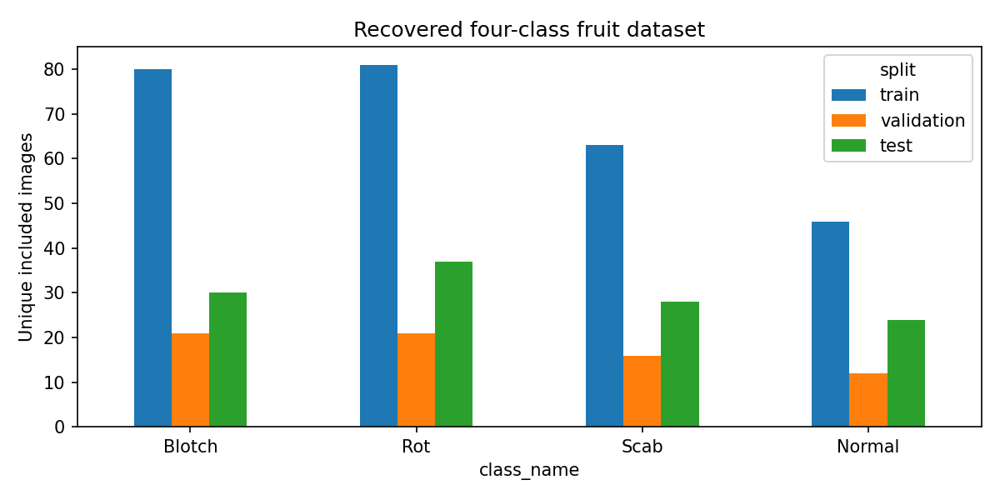
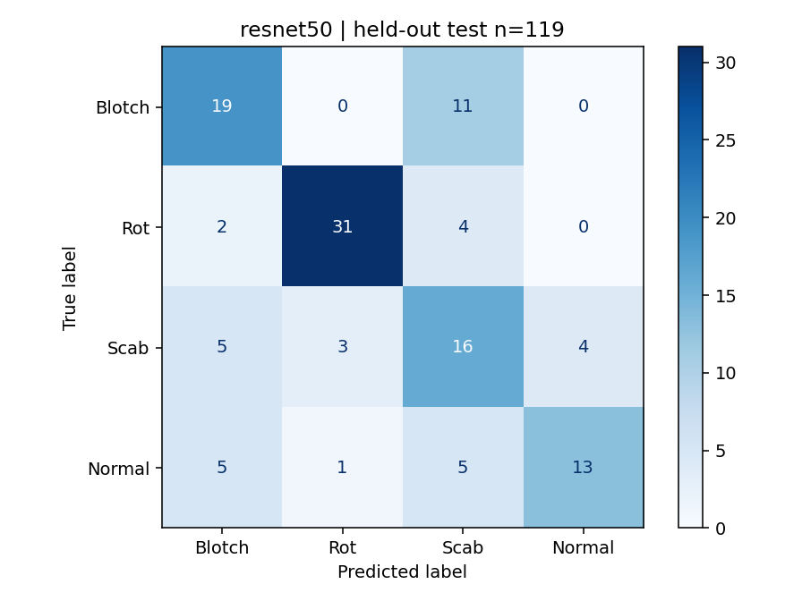
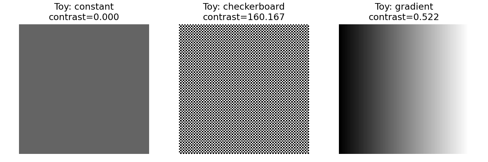

# Apple Disease Detector

A tested TensorFlow/Keras study of **four-class apple fruit classification**, with
GLCM + ANN, a custom CNN, ResNet50 transfer learning, K-means inspection, and a
separate YOLO/Roboflow detection workflow. Rebuilt in October 2026 from an existing
internship repository. [Interview preparation: 56 questions](docs/INTERVIEW_PREPARATION.md).

**Evidence first:** the recovered classification dataset contains 502 files and
472 unique images, including fruit photographs. After exclusions, 459 images are
used. It does **not** substantiate “3,000+ labelled leaf images” for these classifiers.
Dataset publisher/license and expert label validation remain unverified. The raw
images are local and are not redistributed. See [the full audit](docs/DATASET.md).

## Run the working demo

On the current Windows workspace, the three evaluated checkpoints already exist:

```powershell
cd C:\Users\skg21\Documents\projects\Apple_disease_detection
.\venv\Scripts\python.exe -m streamlit run app.py
```

Open http://localhost:8501. Upload an apple fruit image, choose an available model,
inspect all four probabilities, then open K-means or texture features. Confidence
below 60% triggers a warning; that threshold is not calibrated. Unknown objects and
leaf images can receive confident incorrect predictions. The app disables custom
disease detection until a suitable trained detector is registered.

For a fresh environment (Python 3.12 was tested):

```powershell
python -m venv venv
.\venv\Scripts\python.exe -m pip install -r requirements.txt
.\venv\Scripts\python.exe -m pytest
.\venv\Scripts\python.exe -m streamlit run app.py
```

A fresh clone contains code and measured reports, but no new model binaries or raw
dataset. The app handles missing checkpoints and still provides clustering/texture
inspection. Train the models using lawfully obtained data or copy your existing
`artifacts/ann`, `artifacts/cnn`, `artifacts/resnet50` directories, including metadata.
The older six-class release checkpoint is incompatible with this app.

## Verified dataset

Source: recovered local `apple_disease_classification/Train` and `Test`, matching
class names and counts referenced in the historical notebooks' Kaggle paths.
Matching filenames/counts do not prove byte-for-byte identity to the internship archive.
No replacement dataset or disease-label substitution was used.

| Class (output index) | Raw files | Included | Train | Validation | Test |
|---|---:|---:|---:|---:|---:|
| Blotch (0) | 146 | 131 | 80 | 21 | 30 |
| Rot (1) | 152 | 139 | 81 | 21 | 37 |
| Scab (2) | 113 | 107 | 63 | 16 | 28 |
| Normal (3) | 91 | 82 | 46 | 12 | 24 |
| **Total** | **502** | **459** | **270** | **70** | **119** |

All 502 files decoded. Byte/pixel SHA-256 found 472 unique images. Excluded: 30 exact
copies, 11 training images related to original test images, and 2 images in a
conflicting-label group. Perceptual hashes across eight rotations/reflections found
96 exact/near candidate pairs; connected groups stay together. A manual sample review
confirmed recompressed/resized copies. Undetected source relationships remain possible.

The original test set is retained after audit; related Train files are excluded.
Remaining Train groups are allocated per class to approximately 80/20 train/validation
with seed 42. Image content hashes are checked before training. Augmentation is
training-only; it does not increase unique-image counts. All models use the same
[manifest](results/four_class/manifest.csv). The historically used test data is held
out from these new fits, but is not a prospective independent orchard test.



## Measured classification results

These are **new CPU experiments** on the same 119 held-out images, using the fixed
configuration in [four_class.json](configs/four_class.json). Checkpoints and the
selected architecture use validation loss, never test scores. No model settings were
tuned after inspecting these test results.

| Model | Test accuracy | Macro precision | Macro recall | Macro F1 | Weighted F1 |
|---|---:|---:|---:|---:|---:|
| ANN on GLCM | 48.74% | 0.4557 | 0.4530 | 0.4439 | 0.4795 |
| Custom CNN | 46.22% | 0.2390 | 0.4173 | 0.2969 | 0.3358 |
| ResNet50, selected frozen head | **66.39%** | **0.6769** | **0.6461** | **0.6546** | **0.6703** |

ANN trained 60 epochs. CNN stopped after 9, selecting epoch 3. ResNet50 trained 5
frozen-head epochs and 4 fine-tuning epochs. Fine-tuning worsened validation loss
(best ~0.7293 versus frozen ~0.6825), so **the frozen-head checkpoint remains selected**.
ResNet validation accuracy is 81.43%; the lower test result illustrates uncertainty
and distribution differences in this small dataset. The weak CNN is reported as measured.

[Comparison CSV](results/four_class/model_comparison.csv) ·
[ANN per-class metrics](results/four_class/ann/metrics.json) ·
[CNN per-class metrics](results/four_class/cnn/metrics.json) ·
[ResNet per-class metrics](results/four_class/resnet50/metrics.json) ·
[Full experiment explanation](docs/EXPERIMENTS.md).

Each run saves predictions, probabilities, histories, learning curves, architecture,
configuration, preprocessing metadata and evaluated checkpoint SHA-256. Manifest
fingerprints normalize line endings for Windows/Linux consistency; original Windows
file hashes are also retained. Detection metrics are never mixed into this table.



## Methods and design

**K-means:** convert uint8 RGB to floating-point Lab color. Fit seeded K-means with
10 initializations on up to 10,000 pixels and assign every pixel to a color cluster.
Examples compare K=2,3,4. Clusters can mix background, shadows and lesions; there is
no automatic biological lesion identification or claimed segmentation accuracy.
Generate the real local input/reconstruction/cluster example with
`python -m apple_disease.examples`; see `results/local_examples/kmeans_example.png`.
The raw-photo montage stays local because image rights are unverified.

**GLCM:** grayscale luminance quantized to 32 levels; distances 1,2,4 pixels and
angles 0°,45°,90°,135°; symmetric normalized co-occurrence matrices. Contrast,
homogeneity, energy, correlation and dissimilarity each contribute mean/std across
12 matrices, giving 10 numerical features. Constant and invalid inputs are tested.
The ANN uses whole-image texture; K-means is a separate inspection experiment.



**ANN:** 10 -> training-only Normalization -> Dense(32, ReLU, L2) -> Dropout(0.25)
-> Dense(16, ReLU) -> Softmax(4). 969 parameters including normalization state.
Scaler values and feature order are saved with the model.

**CNN:** RGB 96x96 -> training augmentation -> /255 -> three Conv3x3/BatchNorm/ReLU/
MaxPool blocks with 16,32,64 channels -> global average pool -> Dropout(0.3) ->
Softmax(4). Spatial shapes are 48x48x16, 24x24x32, 12x12x64; 24,180 parameters.

**ResNet50:** official Keras ImageNet backbone without its classifier. RGB becomes
BGR and ImageNet means are subtracted, matching official preprocessing. At 96x96,
the backbone emits 3x3x2048; global pooling and dropout feed a four-class head.
First freeze the backbone and train the head; then reload the best head and unfreeze
only final-block convolutions at a lower learning rate. All BN stays frozen and
uses stored statistics. Tests verify those exact behaviors and saved-model parity.

**Training:** seed 42, batch 16, Adam, sparse cross-entropy, train-only class weights,
EarlyStopping and ModelCheckpoint on validation loss. Image models augment only
training inputs. The environment has Python 3.12.6, TensorFlow 2.20.0 and Intel Iris
Xe graphics; TensorFlow sees no GPU and `nvidia-smi` is unavailable. Existing cached
ImageNet weights were reused. No drivers or unrelated processes were changed.
[Environment record](docs/environment_four_class.json).

## YOLO and Roboflow

The separate [detection workflow](docs/YOLO_ROBOFLOW.md) validates real bounding-box
exports, trains Ultralytics YOLO, evaluates the best checkpoint using precision,
recall, mAP@0.5 and mAP@0.5:0.95, and renders boxes/class names. Format validation
cannot establish annotation quality. Local Roboflow ZIP import is tested; remote
version download uses an environment API key and was not run without credentials.

A real generic YOLO11n inference demo completed. It incorrectly labelled the chosen
apple “cake” at 0.6384 confidence. [Saved evidence](results/four_class/yolo_pretrained_example.json)
is deliberately described as an inference demonstration, with no disease metrics.
Custom disease detection training/evaluation remains incomplete. Older local YOLOv5
files contain leaf boxes and different classes; their historical one-epoch validation
log is documented separately and is not presented as a new test benchmark.
The recovered detection split failed validation: the same image occurs in validation
and test under different filenames. [Failure evidence](results/four_class/legacy_detection_audit.json)
records the matching hashes; those unchecked splits are not used for a new detector.

## Reproduce the classification experiments

Place the lawful original data in `apple_disease_classification/{Train,Test}/`
with the four `*_Apple` folders. The committed manifest refers to those relative paths.
For exactly matching recovered data, use it directly:

```powershell
python -m apple_disease.train --model ann --output artifacts/ann
python -m apple_disease.train --model cnn --output artifacts/cnn
python -m apple_disease.train --model resnet50 --output artifacts/resnet50
python -m apple_disease.report
python -m apple_disease.examples
python -m pytest
```

Existing run directories are protected against overwriting. On this workspace these
runs are already complete: no retraining is needed for the demo. To study a genuinely
new dataset, prepare a new manifest and use new run paths, explicitly documenting
that those results are a different experiment:

```powershell
python -m apple_disease.data --root path/to/data --output results/new_audit
python -m apple_disease.train --model ann --root path/to/data --manifest results/new_audit/manifest.csv --output artifacts/new_ann
```

ResNet50 uses official ImageNet weights; construction requires cached weights or
network access. Unit tests use random weights solely to test contracts and do not
claim those tests as transfer-learning results.

## Repository map

```text
apple_disease/                 Active four-class implementation
  data.py                     Auditing, duplicate groups, manifests, splits
  preprocessing.py            Shared RGB decoder and input validation
  segmentation.py             Lab K-means
  features.py                 Quantized GLCM features
  models.py / resnet.py        ANN, CNN, ResNet50
  train.py / evaluation.py     Training, checkpointing, held-out metrics
  inference.py                Checkpoint integrity and shared app inference
  detection.py                Separate YOLO validation/training/inference
  roboflow_import.py           Local export import and optional API download
  examples.py / report.py      Genuine examples and compact result exports
app.py                        Streamlit demo
configs/four_class.json        Explicit class order and hyperparameters
results/four_class/            Audits, manifests and measured new experiments
artifacts/                    Local ignored evaluated checkpoints
results/local_examples/       Local ignored source-photo visualizations
original_work/                Preserved original notebooks
src/, scripts/, configs/config.yaml, results/* outside four_class/
                              Preserved prior six-class PyTorch project
```

Default `pytest` runs the active four-class suite. Older tests directly under
`tests/` belong to the prior PyTorch implementation and are not included in its
claim. Its original dependencies are preserved in `requirements-legacy-six-class.txt`.
The original six-class README is accessible in [the preserved Git history](https://github.com/Tanishgupta28/apple-disease-detection/blob/d7767f5/README.md).

## Limitations and next steps

- The recovered fruit data does not establish the resume's 3,000+ leaf-image claim.
- Source/license, independent label review and source-group metadata are incomplete.
- The small historically exposed test set is not independent field validation.
- Related images remain within splits, and perceptual grouping can miss or overgroup copies.
- Softmax is uncalibrated; there is no reliable unknown-image rejection.
- K-means has no lesion masks; YOLO has no newly verified custom disease benchmark.
- One seed and a bounded CPU training budget; no multi-seed study or calibrated intervals.

Priorities are expert-reviewed, clearly licensed task-matched data, source-group
splits and independent orchard testing, then calibration and targeted model ablations.

Start interview revision with [INTERVIEW_PREPARATION.md](docs/INTERVIEW_PREPARATION.md),
[DATASET.md](docs/DATASET.md), and [EXPERIMENTS.md](docs/EXPERIMENTS.md). Keep new
implementation, completed experiments and historical personal experience distinct.

Code: MIT. Dataset, pretrained weights and optional dependencies retain their own
licenses. Technical references: [Keras ResNet](https://keras.io/api/applications/resnet/),
[TensorFlow transfer learning](https://www.tensorflow.org/guide/keras/transfer_learning),
[scikit-image GLCM](https://scikit-image.org/docs/stable/auto_examples/features_detection/plot_glcm.html),
[Ultralytics detection](https://docs.ultralytics.com/datasets/detect/),
[Roboflow export](https://docs.roboflow.com/datasets/create-and-upload/download-a-dataset).
